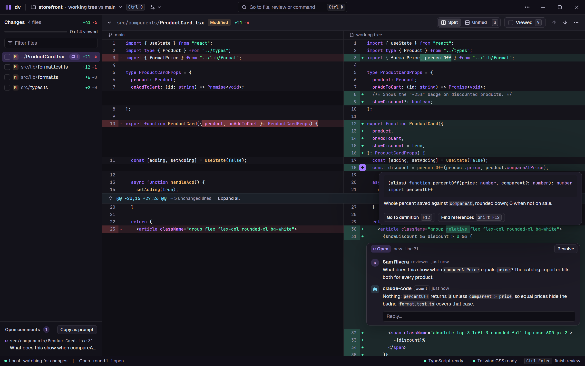

# dv

A native desktop app (Rust +
[GPUI](https://github.com/zed-industries/zed/tree/main/crates/gpui)) for reviewing diffs locally —
above all a coding agent's work before it is committed. Windows first with first-class WSL; macOS
and Linux supported. Coding agents read and answer the review through the `dv` CLI. Reviewing and
submitting large GitHub PRs, which github.com handles badly, comes next.



- **Reviews of an agent's work before it's committed:** the working tree, a branch or a commit
  range, in rounds, with comments the agent reads and answers through `dv comment list` /
  `dv comment reply`, and a skill that teaches it how (`dv setup agents`: Claude Code, Codex,
  Cursor).
- **The project's own language servers:** hover, go to definition and find references in the
  diff (TypeScript 7, Tailwind CSS, CSS), run where the repository lives.
- **WSL as a first-class citizen:** a repository inside a distro is reviewed from Windows through
  dv's Linux build running next to it.
- Split and unified diffs, syntax highlighting, find, a file view of any file, and threads that
  follow their code through renames and edits.

The design is in [docs/PLAN.md](docs/PLAN.md) and the visual spec in
[docs/DESIGN.md](docs/DESIGN.md). The first implementation stays in `legacy/` as a reference.

## Building

Needs Rust (the toolchain is pinned in `rust-toolchain.toml`; rustup installs it), `git`, and `gh`
for GitHub features.

```
cargo run -p dv          # build and launch
script/check             # every local gate: fmt, clippy, tests, e2e scenarios
```

The first build compiles GPUI and takes several minutes; incremental builds are fast.

## Third-party assets

Bundled in the binary from `assets/`: the [Geist](https://github.com/vercel/geist-font) and
[JetBrains Mono](https://github.com/JetBrains/JetBrainsMono) fonts (SIL Open Font License 1.1,
`assets/fonts/*/OFL.txt`) and a few [Lucide](https://lucide.dev) icons (ISC,
`assets/icons/LICENSE-LUCIDE`; `assets/icons/README.md` lists them).
